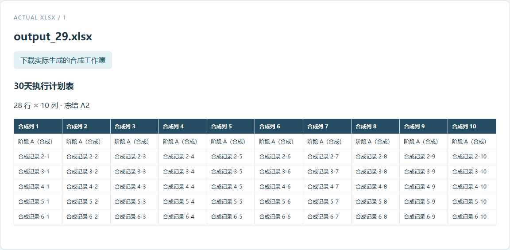
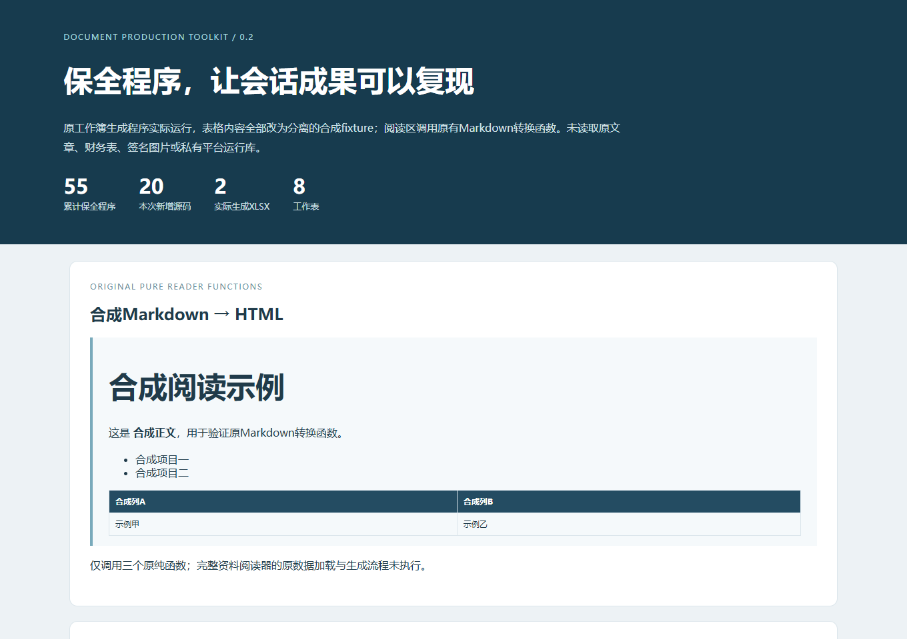

# Document Production Toolkit · 文档制作工具箱

把简历、演示文稿、奖学金申请表和素材索引背后的程序保存为可检查的项目：保留55个历史脚本版本，以合成材料重现简历、工作簿生成与Markdown转换子流程。

**状态：源码归档与合成示例 · Python 3.12实测 · Office流程待验证**





0.2新增20个会话程序，见[会话源码与验证范围](docs/session-guide.md)。0.1的35个源码与已验证DOCX结果完整保留。

## 能做什么

- 浏览55个脚本的来源、版本、依赖与执行边界，50个Python程序、4个PowerShell程序和1个JavaScript程序均保留。
- 使用原简历生成函数与完整四变体循环，实际生成4份合成DOCX、段落内容预览和文件哈希。
- 默认阻断Office、联网抓取和原素材整理；输出目录必须全新，避免覆盖已有材料。

## 快速上手

准备Python 3.12，在项目目录执行：

```sh
python -m venv .venv
# Windows: .venv\Scripts\activate
# macOS/Linux: source .venv/bin/activate
python -m pip install -r requirements.txt
python -m document_toolkit doctor
python -m document_toolkit list
python -m document_toolkit check
python -m document_toolkit demo --output demo-output
python -m document_toolkit session-demo --output session-output
```

打开 `demo-output/review/index.html` 查看真实生成DOCX的段落内容并下载文件。重新生成时指定另一个新目录。页面是内容检查视图，Word的真实分页、打印外观与PDF导出需在对应环境另行验证。

```sh
python -m unittest discover -s tests -v
```

本机使用python-docx 1.1.2、Pillow 11.0.0、openpyxl 3.1.5完成示例；第三方依赖许可见 [THIRD_PARTY_NOTICES.md](THIRD_PARTY_NOTICES.md)。示例不需要Office、账号、密钥或网络服务。

## 目录与历史工作流

| 目录 | 内容 |
| --- | --- |
| `document_toolkit/` | 索引、语法检查、默认执行门禁与合成运行入口 |
| `archive/career/` | 简历、PPT准备/组装/核验与版本交付脚本20个 |
| `archive/scholarship/` | 申请表、素材整理、答辩计划与组装脚本15个 |
| `archive/session/` | 8个会话的20个独有程序：XLSX修复/核验、阅读器、流程图、文档/表单 |
| `fixtures/` | 分离的合成文本、表格数据与模板内容 |
| `docs/source-map.json` | 原始相对路径与SHA256、公开副本哈希和控制流统计 |
| `docs/archive-guide.md` | 逐程序依赖、原始素材缺口与未验证条件 |
| `site/` | 已运行合成结果的静态预览快照 |

历史PPT/申请表流程依赖的原图、证书、模板、JSON配置、外部渲染器和Office没有打包，需按 [历史脚本说明](docs/archive-guide.md) 自备授权输入并适配。当前可复现验证范围是索引、语法、默认阻断、四变体合成简历、原程序生成的2个合成XLSX（8工作表）与原阅读器3个纯函数。`session-output/review/index.html` 提供真实工作簿内容检查和下载。

## 在线体验与项目状态

仓库提供GitHub Pages工作流：CI先运行测试与两个合成示例，再发布生成的静态内容预览。Pages只展示合成DOCX/XLSX内容和下载，不在浏览器中运行Word/PowerPoint或处理用户上传材料。发布后的实际仓库/预览地址由仓库维护者填写。

查看 [更新记录](CHANGELOG.md)、[数据边界](docs/PRIVACY.md) 与 [来源索引](docs/source-map.json)。原始个人证据材料没有公开，仍需自行保留。

## 许可

原创程序与本次适配采用MIT。未复制商业字体、Office程序、第三方图片或真实个人照片；几何占位图与README截图均来自本项目合成示例。可选PyMuPDF等依赖有独立许可，详见第三方说明。
